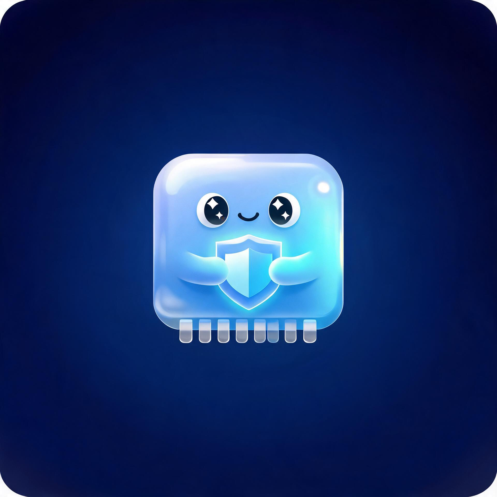

# 东青MemGuard

一款为 macOS 打造的轻量级内存监控与自动清理工具。常驻菜单栏，实时显示内存占用，按机器内存容量自动设定阈值，超出后自动回收无用内存。界面采用苹果玻璃（Glass）风格，安静地待在顶部，不打扰你。



## 功能特性

- **菜单栏常驻实时显示** — 顶部直接显示当前内存占用百分比，鼠标悬停查看「已用 / 总量」详情
- **智能阈值自适配** — 根据机器总内存自动推荐阈值：8G 机型 82%、16G 机型 85%、32G 机型 88%、更大机型 90%
- **自动清理** — 占用超过阈值后自动回收无用内存，带冷却机制与安全边界，避免频繁触发
- **玻璃风格面板** — 点击菜单栏图标弹出毛玻璃面板，含内存环形图、历史走势、压力等级、进程排行
- **进程一键退出** — 面板内直接查看占用最高的进程并一键结束
- **两档清理强度** — 免密清理（常规回收）与深度回收（`purge`，需管理员授权）

## 系统要求

- macOS 13.0 或更高版本
- 支持 Apple Silicon 与 Intel 机型

## 安装

1. 前往 [Releases](../../releases) 页面下载最新版 `DongqingMemGuard-v1.0.4.dmg`
2. 打开 DMG，将「东青MemGuard」拖入「应用程序」文件夹
3. 首次启动若提示「无法验证开发者」，请在「系统设置 → 隐私与安全性」中点击「仍要打开」

## 使用

启动后应用会常驻菜单栏顶部：

- 点击菜单栏图标 → 展开内存面板
- 面板内可开关「自动清理」「深度回收」，并手动调整阈值
- 右上角关闭面板，应用继续在后台静默守护

### 如何退出

- **右键**菜单栏图标 → 选择「退出东青MemGuard」（或按 ⌘Q）
- 或打开面板，点击右上角电源图标，或底部「退出」按钮

## 更新日志

### v1.0.4

- **主题色改用亮绿色 #c1fd55**：整体视觉更清爽，进度环、折线、滑块、开关统一为新主题色
- **显著提升可读性**：亮绿底上的文字改为深色（`onAccent`），「立即清理」「一键授权」等按钮文字不再发白看不清
- 玻璃卡片按明暗模式自适应底色与描边，浅色模式下白描边「看不见」的问题已修复
- 统计行配色（联动内存 / 已压缩 / 缓存文件）与新主题色协调统一
- 压力徽章文字改用主文本色，描边加深，辨识度更高

### v1.0.3

- **修复隐藏状态下 CPU 周期性飙高**：面板关闭时不再向 SwiftUI 推送数据、也不再采集进程列表，实测 CPU 由最高 13% 峰值降到稳定 0.0–0.3%
- 打开面板时再按需刷新，数据仍是实时最新的

### v1.0.2

- **修复退出失效**：右键菜单改为在菜单收起后才摘除，避免菜单一闪而过点不中
- 面板右上角新增常驻「退出」按钮，不必再翻到底部
- 退出统一走 `AppQuit`：先收起窗口再终止，并有 0.6 秒强制退出兜底

### v1.0.1

- **修复卡死**：管理员授权（osascript）与外部命令全部移出主线程，并加入超时保护，不再阻塞界面
- **新增退出入口**：菜单栏右键原生菜单（打开面板 / 立即清理 / 退出），面板底部「退出」按钮带文字更醒目
- **自动清理更安全**：自动模式只回收系统内存（purge），不再自动删除用户缓存/日志/临时文件；冷却时间放宽到 30 分钟
- 移除会误删内容的「清空废纸篓」逻辑

## 从源码构建

```bash
# 编译并组装 .app
bash Packaging/build_app.sh

# 打包 DMG
bash Packaging/make_dmg.sh
```

生成产物位于 `dist/` 目录下。

## 项目结构

```
MemGlass/
├── Package.swift              # SPM 工程配置（macOS 13+）
├── Sources/MemGlass/
│   ├── main.swift             # 应用入口
│   ├── AppDelegate.swift      # 菜单栏项、弹出面板、生命周期
│   ├── MemoryMonitor.swift    # 采样调度与阈值自适配
│   ├── MemorySampler.swift    # 内存采样与进程统计核心
│   ├── CleanerModel.swift     # 清理引擎（免密 / 深度回收 / 自动清理）
│   ├── PanelView.swift        # 主面板布局
│   └── Support.swift          # 玻璃风格 UI 组件库
└── Packaging/
    ├── Info.plist             # 应用信息配置
    ├── build_app.sh           # 构建脚本
    ├── make_dmg.sh            # DMG 打包脚本
    ├── make_icon.swift        # 图标生成（squircle 遮罩）
    └── AppIcon.icns           # 应用图标
```

## 技术说明

- 纯原生实现：Swift 6 + SwiftUI + AppKit，无第三方依赖
- 内存数据来自 `host_statistics64` 与 `sysctl` 系统调用
- 进程统计基于 `ps` 采集，并按应用归并
- 深度回收通过 `purge` 命令，需要管理员授权

## 许可

本项目仅供学习与个人使用。